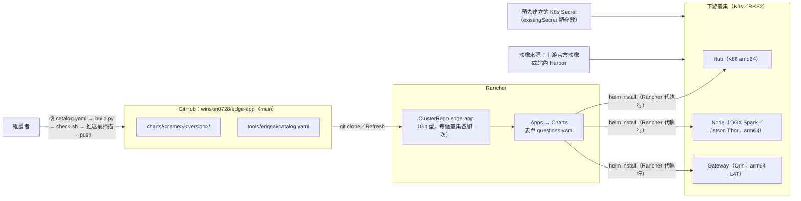

# edge-app 套件庫操作手冊

| 項目 | 內容 |
|---|---|
| 文件版本 | v1.0（2026-11-22，新建） |
| 適用內容 | `main` @ `e560b71`：既有 4 個 chart＋32 個 `edgeai-*` 開源套件 chart |
| 對象 | 在 Rancher 管理的 K3s／RKE2 叢集上部署 Edge AI 應用的維運人員 |
| 相關文件 | `EDGE-AI-CHARTS.md`（清單、授權、更新流程）、`tools/edgeai/VERIFY.md`（驗證紀錄）、各 chart 的 `README.md`／`app-readme.md` |

> 本 repo 是**公開** repo。chart、範例與本手冊都不含密碼、金鑰、token，也不寫內部 IP 或主機名稱；需要位址的地方一律用 `<…>` 或 `${…}` 變數。

---

## 1. 產品定位與適用場景

### 1.1 定位

`edge-app` 是 Rancher 的 **Git 型 Helm 套件庫**：Rancher 直接讀 `charts/<name>/<version>/`，不需要 `index.yaml`。叢集加入這個套件庫後，在 Rancher「Apps → Charts」就能以表單安裝 Edge AI 平台需要的應用。

收錄兩類 chart：

| 類別 | 說明 |
|---|---|
| 既有應用 chart | `vlm-app`、`srs`、`doublinks`、`zerotier-planet` |
| Edge AI 開源套件 chart（`edgeai-*`） | Edge AI 平台三層架構（Hub／Node／Gateway）Layer 1 直接部署的開源軟體，共 32 個，依 Pack 分類 |

### 1.2 適用場景

| 場景 | 做法 |
|---|---|
| 在新的 Edge 叢集部署 AI 推論、影像、IoT、RAG 等應用 | 叢集加入本套件庫（§4），從 Apps → Charts 安裝 |
| 離線站點 | 把各 chart 的映像參數改指向站內 Harbor（§6.3） |
| 不經 Rancher、用 `helm` CLI | 用 `tools/edgeai/package-index.sh` 產生 HTTP 型索引（§4.4） |
| 只想看清單與授權風險 | `EDGE-AI-CHARTS.md` §1、§3 |

不收錄：Rancher 已內建的元件（cert-manager、Rancher Monitoring、Longhorn、Fleet 等）、非 K8s 應用、供應商產品（Harmony／Chorus 5GC）。理由見 `EDGE-AI-CHARTS.md`「刻意不做成 chart 的」。

---

## 2. 系統架構

### 2.1 套件庫結構

```
edge-app/
├── charts/
│   ├── <name>/<version>/          Rancher 讀這一層；一個版本一個目錄，舊版保留
│   │   ├── Chart.yaml             含 catalog.cattle.io/* 註記（Pack 側標、預設 namespace）
│   │   ├── values.yaml
│   │   ├── questions.yaml         Rancher 安裝表單
│   │   ├── app-readme.md／README.md
│   │   ├── templates/             自寫 chart 的樣板
│   │   └── charts/                wrapper chart 的上游 tgz（原封不動）
├── tools/edgeai/
│   ├── catalog.yaml               edgeai-* 的單一真相源（版本、預設值、表單、檢查）
│   ├── build.py                   依 catalog.yaml 產生 charts/edgeai-*／更新清單表
│   ├── check.sh                   全部 helm lint／template
│   ├── package-index.sh           打包並產生 HTTP 型 index.yaml（輸出到 repo 外）
│   ├── common/templates/          自寫 chart 共用樣板
│   └── VERIFY.md                  驗證紀錄
├── EDGE-AI-CHARTS.md
└── docs/操作手冊.md               本文件
```

### 2.2 部署位置與資料流



### 2.3 層級

| 層級 | 硬體 | 架構 |
|---|---|---|
| Hub | x86 伺服器 | amd64 |
| Node | DGX Spark、Jetson Thor | arm64 |
| Gateway | Jetson Orin（L4T） | arm64 |

每個 chart 的 `edge-ai/tier`、`edge-ai/arch` 註記標出適用層級與架構。

---

## 3. 功能清單（chart 分類）

### 3.1 既有應用 chart

| Chart | 版本 | 說明 |
|---|---|---|
| `vlm-app` | 0.1.1（app v92） | CCTV 監看：YOLO11＋本地 VLM（Ollama），適用有 NVIDIA GPU 的 k3s／RKE2 節點（x86 RTX 50 系列、Jetson Thor、DGX Spark） |
| `srs` | 1.0.0（app 6.0） | SRS 串流伺服器：RTMP 1935、API 1985、HTTP-FLV／HLS 8080、WebRTC 8000/UDP、SRT 10080/UDP；Ingress 只處理 8080 |
| `doublinks` | 0.1.4 | Doublinks 私有伺服器，支援 Multus macvlan |
| `zerotier-planet` | 0.1.4 | ZeroTier Planet／ZTNCUI，支援 Multus macvlan |

### 3.2 Edge AI 開源套件（32 個，依 Pack）

「wrapper」＝引用上游 chart（tgz 原封放入），只加平台預設值、表單與說明；「自寫」＝用共用樣板寫成。版本都是 0.1.0。

| Pack（預設 namespace） | Chart |
|---|---|
| Access & NAC（`edgeai-access`） | `edgeai-freeradius`（自寫）、`edgeai-headscale`（自寫）、`edgeai-kea-dhcp`（自寫）、`edgeai-keycloak`、`edgeai-step-ca` |
| Vision（`edgeai-vision`） | `edgeai-mediamtx`（自寫）、`edgeai-triton`（自寫） |
| Voice/PTT（`edgeai-voice`） | `edgeai-asterisk`（自寫，映像需自建） |
| IoT/OT（`edgeai-iot`） | `edgeai-edgex`（自寫）、`edgeai-mosquitto`（自寫）、`edgeai-thingsboard`（自寫，選配） |
| RAG（`edgeai-rag`） | `edgeai-litellm`、`edgeai-open-webui`、`edgeai-qdrant`、`edgeai-vllm` |
| MLOps（`edgeai-mlops`） | `edgeai-cvat`、`edgeai-mlflow` |
| Platform（`edgeai-platform`） | `edgeai-argo-cd`（選配）、`edgeai-cloudnative-pg`、`edgeai-gitea`、`edgeai-harbor`、`edgeai-minio`（選配，AGPL）、`edgeai-seaweedfs`、`edgeai-valkey`、`edgeai-velero` |
| Observability（`edgeai-observability`） | `edgeai-grafana`、`edgeai-loki`、`edgeai-otel-collector`、`edgeai-victoria` |
| Security（`edgeai-security`） | `edgeai-external-secrets`、`edgeai-kyverno`、`edgeai-trivy-operator` |

上游版本、層級、架構與授權的完整表格見 `EDGE-AI-CHARTS.md` §1（由 `build.py` 自動產生）。

### 3.3 在 Rancher 上的呈現

- 卡片側標：`catalog.cattle.io/certified` 設為 Pack 名稱。
- 分類篩選：`keywords` 帶 Rancher 分類（Security、Networking、Database、Storage、Monitoring、Repository、Applications、Infrastructure），另有 `edge-ai`、`pack-<key>` 便於搜尋。
- 預設 namespace：`catalog.cattle.io/namespace`（每個 Pack 一個 `edgeai-*`）。
- 安裝表單：`questions.yaml`；陣列型參數（例如 vLLM 模型清單、Velero 備份位置）在安裝畫面用 **Edit YAML**。

---

## 4. 安裝與部署（把套件庫加入叢集）

### 4.1 前置需求

| 項目 | 需求 |
|---|---|
| 叢集 | Kubernetes ≥ 1.28（chart `kubeVersion: >=1.28.0-0`），由 Rancher 管理 |
| 網路 | Rancher 能連到 `github.com`（Git 型 repo）；下游節點能拉到映像（或改用站內 Harbor） |
| 儲存 | 會建 PVC 的 chart（Qdrant、Harbor、Gitea、Headscale、ThingsBoard、CVAT 等）需要 StorageClass |
| GPU | Triton、vLLM 需要可分配的 NVIDIA GPU |
| Secret | 需要秘密的 chart 要先建好 Secret（§6.2） |

### 4.2 Rancher UI（每個叢集各加一次）

1. 進入目標叢集 → **Apps → Repositories → Create**。
2. Target 選 **Git repository containing Helm chart or cluster template definitions**。
3. Git Repo URL：`https://github.com/winson0728/edge-app.git`；Git Branch：`main`。
4. 建立後等狀態為 Active，到 **Apps → Charts** 搜尋 `edge-ai` 或 Pack 名稱。

已經加過 `edge-app` 的叢集不用重加：**Apps → Repositories → edge-app → ⋮ → Refresh**，新 chart 就會出現。

截圖待 Lab 擷取（不截入叢集位址、帳號或 Secret 內容）。

### 4.3 kubectl

```yaml
apiVersion: catalog.cattle.io/v1
kind: ClusterRepo
metadata: {name: edge-app}
spec: {gitRepo: https://github.com/winson0728/edge-app.git, gitBranch: main}
```

```bash
kubectl apply -f clusterrepo-edge-app.yaml
kubectl get clusterrepo edge-app
```

### 4.4 HTTP 型（`helm repo add`、內部 web server、GitHub Pages）

```bash
tools/edgeai/package-index.sh <輸出目錄> <對外 URL>
helm repo add edge-app <對外 URL>
helm search repo edge-app
```

**不要把 `index.yaml` 放在 repo 根目錄**：Rancher 的 Git 型 repo 根目錄有 `index.yaml` 時會改讀它，沒列進去的 chart 會從 Apps 頁消失。輸出放在 repo 外或 `gh-pages` 分支。

### 4.5 驗證

- Rancher：Repositories 中 `edge-app` 為 Active；Apps → Charts 可看到既有 4 個與 32 個 `edgeai-*`（`VERIFY.md` 記錄的索引數為 36）。
- 單一 chart 安裝後：`kubectl -n <namespace> get pods`、依該 chart README 的功能測試（例如 Mosquitto pub/sub、Valkey SET／GET、VictoriaMetrics `/health`）。

### 4.6 回復

| 要回復的對象 | 做法 |
|---|---|
| 已安裝的 App | Rancher：Apps → Installed Apps → 刪除；或 `helm uninstall <release> -n <namespace>`，再視需要刪 namespace 與 PVC |
| App 升級後有問題 | Rancher：Installed Apps → ⋮ → Rollback；或 `helm rollback <release> <revision> -n <namespace>` |
| 套件庫本身 | Apps → Repositories → 刪除 `edge-app`（不影響已安裝的 App），或 `kubectl delete clusterrepo edge-app` |
| chart 版本 | 舊版本目錄都保留，可在安裝或升級時選舊版 |

---

## 5. 日常操作

### 5.1 安裝一個 App（UI）

1. Apps → Charts → 找到 chart（可用 Pack 側標或 `edge-ai` 篩選）。
2. 看安裝頁頂端的 `app-readme.md`：前置條件、需要的 Secret、架構限制。
3. 先在預設 namespace（或自訂）建好需要的 Secret（§6.2）。
4. 填表單（`questions.yaml`）；陣列參數用 **Edit YAML**。
5. Install，等 Pod Ready，再依 chart README 做功能測試。

### 5.2 CLI 安裝（從 repo clone）

```bash
git clone https://github.com/winson0728/edge-app.git
helm install <release> ./edge-app/charts/<name>/<version> -n <namespace> --create-namespace -f <私有 values 檔>
```

### 5.3 升級

- 在 Refresh 套件庫後，Installed Apps 會在有新版本時標示可升級；升級前先看該 chart README 的變更與 values 差異。
- wrapper chart 的參數放在上游 key 底下，自訂 values 時要依該 chart README 的層級寫。

### 5.4 維護者：更新或新增 chart

1. 改 `tools/edgeai/catalog.yaml`（上游 `version`、自寫的 `appVersion`／映像 tag、平台預設值、表單、`validate`、`ci`）。
2. **chart 有任何改動就把該 chart 的 `version` 加一**，產生新目錄 `charts/<name>/<新版>/`；舊版目錄保留，已安裝的 App 才看得到「可升級」。
3. 下載上游 tgz 到快取目錄（`helm pull`，見 `build.py` 開頭說明）後執行：
   ```bash
   python tools/edgeai/build.py --cache <快取目錄>     # 重產 chart 與 EDGE-AI-CHARTS.md 的清單表
   bash tools/edgeai/check.sh                         # 全部 helm lint／template
   ```
4. **推送前掃描**：不得含密碼、金鑰、token、內部 IP 或主機名稱。
5. 推到 `main` 後，到各叢集 Refresh。

`vlm-app`、`srs`、`doublinks`、`zerotier-planet` 不經 `build.py`，直接改各自目錄並遞增版本。

---

## 6. 設定參數說明

### 6.1 共通註記（`Chart.yaml`）

| 註記 | 用途 |
|---|---|
| `catalog.cattle.io/display-name` | Rancher 顯示名稱 |
| `catalog.cattle.io/certified` | Pack 側標（不用保留值 `rancher`、`partner`） |
| `catalog.cattle.io/namespace`、`release-name` | 預設 namespace 與 release 名稱 |
| `catalog.cattle.io/os`、`permits-os` | `linux` |
| `catalog.cattle.io/kube-version` | `>=1.28.0-0` |
| `edge-ai/pack`、`tier`、`arch`、`license`、`chart-kind` | 平台用的分類與授權標記 |

### 6.2 秘密資料

- chart 與 repo 不含任何密碼、金鑰或 token；需要秘密的地方都是「Secret 名稱」參數（`existingSecret` 類）。
- 會落到上游預設密碼的 chart（Harbor、Gitea、Keycloak、MinIO、LiteLLM、FreeRADIUS、Mosquitto、EdgeX）有安裝前檢查，**沒給 Secret 會直接拒絕安裝**。
- Secret 的 key 名稱依各 chart README；建立方式例：
  ```bash
  kubectl -n <namespace> create secret generic <secret 名稱> --from-file=<key>=<私有檔案>
  ```
  不要把值寫在命令列或 values 檔裡提交。

### 6.3 映像與架構

- 自寫 chart 的映像位置是參數（`components.<name>.image.repository／tag`），離線站點改指向站內 Harbor。
- 例外：
  - **Asterisk** 沒有官方映像，`image.repository` 必填（自建）。
  - **Kea** 官方映像只有 amd64，arm64 需自建。
  - **Harbor** 官方映像只有 amd64，chart 預設 nodeSelector amd64。
  - **vLLM** 官方映像以 amd64 為主，Thor／Spark 用 NVIDIA 的 arm64 映像。
  - **Triton** Orin 需 JetPack 版映像。

### 6.4 授權注意

| 類別 | Chart | 注意 |
|---|---|---|
| AGPL-3.0 | Grafana、Loki、MinIO | 不修改原始碼、保留 source offer；物件儲存預設用 SeaweedFS |
| GPL-2.0 | FreeRADIUS、Asterisk | 獨立容器、不修改；Asterisk 映像自建，散布附原始碼取得方式 |
| 自訂授權 | Open WebUI | 白牌前法務確認 |
| NVIDIA EULA | Triton | 不重新打包映像 |
| Bitnami 子 chart | LiteLLM、CVAT、MLflow、Gitea 的選用資料庫 | Bitnami 免費映像 2025-08 起移到 `bitnamilegacy`、不再更新；正式站建議改接 CloudNativePG／Valkey |

---

## 7. 常見問題與故障排除

| 症狀 | 原因 | 處置 |
|---|---|---|
| Apps → Charts 看不到新 chart | 套件庫尚未 Refresh | Repositories → edge-app → Refresh |
| 部分 chart 從 Apps 頁消失 | repo 根目錄出現 `index.yaml` | 移除根目錄的 `index.yaml`；HTTP 索引放到 repo 外 |
| 安裝時 template 失敗、訊息要求 Secret | 安全檢查：沒給必填 Secret | 先建 Secret，在表單填 Secret 名稱 |
| Pod Pending，PVC 未綁定 | 叢集沒有 StorageClass | 安裝 StorageClass（例如 local-path）或在表單指定 |
| Pod Pending，GPU 不足 | Triton／vLLM 要 GPU，或 GPU 已被其他服務占用 | 釋放 GPU 或排到有 GPU 的節點 |
| arm64 節點 `exec format error` | 映像只有 amd64（Kea、Harbor、vLLM 官方） | 改用 arm64 映像或排到 amd64 節點 |
| Kea／Asterisk 裝了以後節點埠衝突 | `hostNetwork` 占用節點埠 | 確認節點上沒有其他 DHCP／SIP 服務 |
| 裝 operator 類 chart 後影響既有服務 | CloudNativePG、Kyverno、Trivy Operator、External Secrets、Velero、Argo CD 是叢集層級 | 先在 Lab 驗證；Kyverno 政策先用 audit 模式（待確認預設值） |
| FreeRADIUS 只聽 IPv4 | chart 刻意改成只聽 IPv4（Pod 網路聽 IPv6 `::` 會失敗） | 預期行為 |
| MediaMTX 的 API／metrics 連不到 | NetworkPolicy 限制在 release 內 | 預期；需要時調整 NetworkPolicy 參數 |
| EdgeX 服務起不來 | 服務綁 `SERVICE_HOST`、DB 密碼需經 bootstrapper 下發 | chart 已處理（`SERVICE_SERVERBINDADDR=0.0.0.0`、initContainer 等待 metadata）；確認 Secret 正確 |

### 7.1 在 Edge 備援核網或 5G 設備所在叢集安裝時

Jetson Thor 等節點可能同時跑 5G Edge（Chorus）與其他試驗。安裝 `hostNetwork` 類 chart（Kea、Asterisk）或叢集層級 operator 前，先與該節點的負責人確認，避免占用 5G 相關埠或影響既有 Pod。節點重開後 5G Edge 相關的處理不在本套件庫範圍，請看對應專案的操作手冊。

---

## 8. 版本與變更紀錄

### 8.1 本手冊

| 版本 | 日期 | 說明 |
|---|---|---|
| v1.0 | 2026-11-22 | 新建 |

### 8.2 套件庫

| commit | 說明 |
|---|---|
| `e560b71` | 新增 32 個 `edgeai-*` 開源套件 chart、`tools/edgeai/`、`EDGE-AI-CHARTS.md`、`VERIFY.md` |
| `3fe53ab` | 新增 `vlm-app` 0.1.1 |
| 更早 | `srs` 1.0.0、`doublinks` 0.1.4、`zerotier-planet` 0.1.4 |

### 8.3 驗證狀態（摘自 `tools/edgeai/VERIFY.md`）

- 32 個 `edgeai-*` 全部 helm lint／template 通過。
- 已在 Lab 單節點叢集實裝並做功能測試：mosquitto、freeradius、mediamtx、edgex、valkey、victoria；其餘只做 lint／template。
- Rancher 以 HTTP 型臨時索引讀取 36 個 chart 正確；Git 型要推到 `main` 並 Refresh 後才會出現。

### 8.4 待確認事項

- Layer 2 自研模組的 11 個骨架 chart 尚未推上 `main`，不在本手冊範圍。
- 需要 GPU、PVC、叢集層級 operator、`hostNetwork` 或外部資料庫的 chart 還沒做第二輪實裝驗證（見 `VERIFY.md` §5）。
- 根目錄 `README.md` 目前是 SRS 的說明，是否改成套件庫總覽待決定。
- 各 chart Secret 的 key 名稱以各自 README 為準，本手冊未逐一列出。
